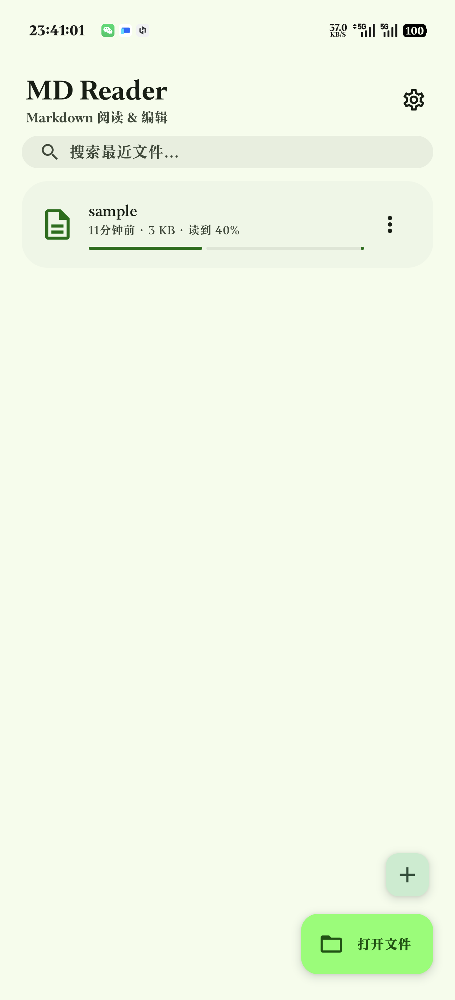
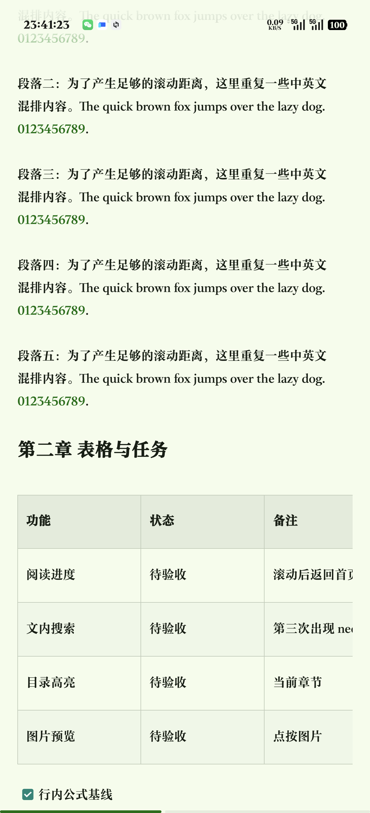
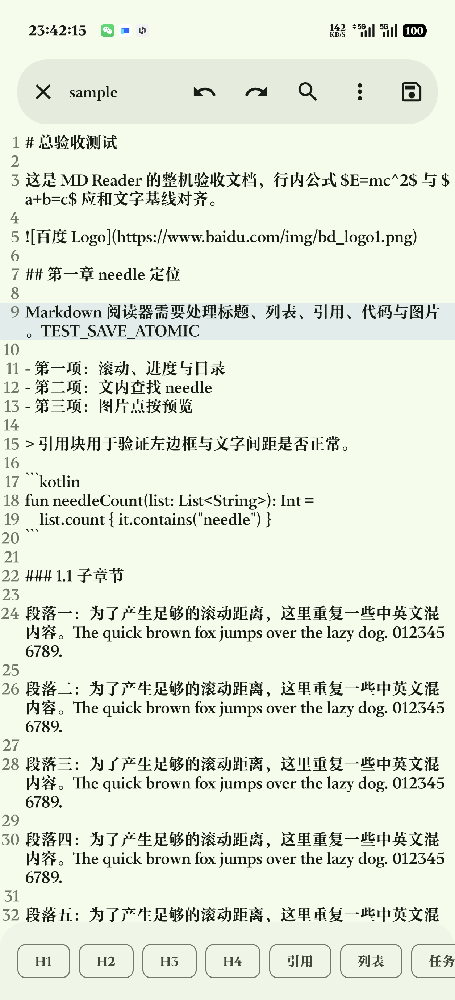
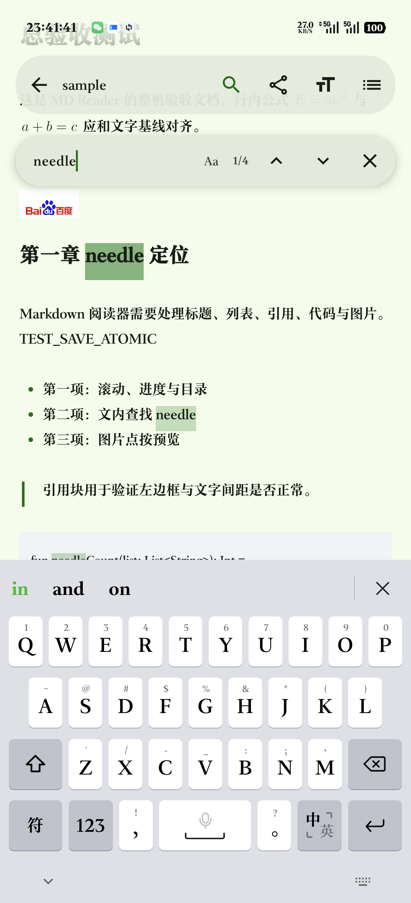
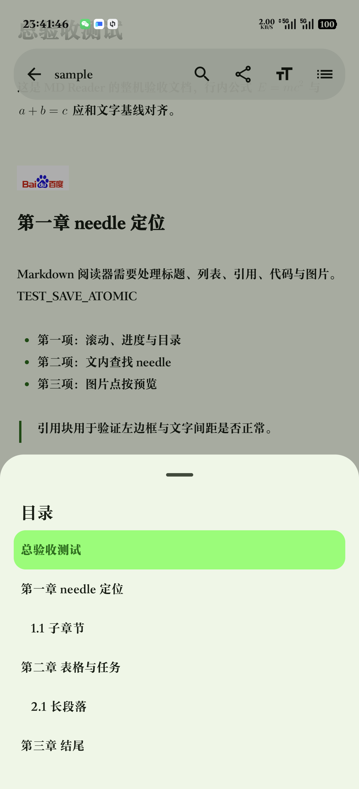
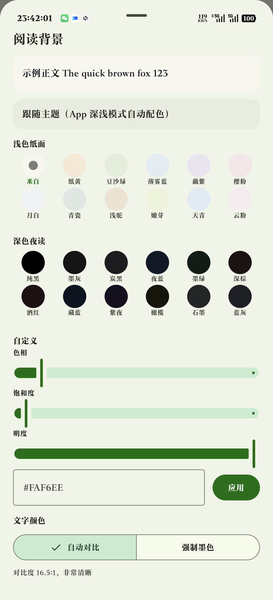
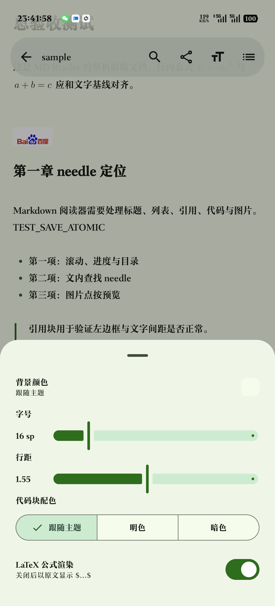

# MD Reader

一款功能完整的 Android Markdown 阅读器与编辑器，基于 Jetpack Compose 和 Markwon 构建。

<p align="center">
  <strong>轻量 · 快速 · 离线优先</strong>
</p>

---

## 截图预览

<p align="center">
  
  
  
</p>

<p align="center">
  
  
  
</p>

---

## 功能特性

### 阅读模式


- **原生渲染** — 基于 Markwon 4.6.2，支持表格、任务列表、删除线、软换行、内联 HTML、链接识别
- **LaTeX 公式** — 支持 `$$...$$` 块级公式和 `$...$` 行内公式，行内公式使用基线对齐 + LRU 缓存（64 条）
- **阅读进度** — 底部 3dp 进度条 + 滚动时显示"xx% · 章节"胶囊提示（1.2 秒后自动隐藏）
- **章节目录** — 层级化章节导航，当前章节高亮，点击跳转
  <p align="left"></p>
- **文档内搜索** — 匹配高亮、`1/4` 计数、上/下切换、`Aa` 区分大小写开关、搜索词历史（最多 8 条，DataStore 持久化）
  <p align="left"></p>
- **长按选择文本** — 自定义长按手势 → 系统文本选择手柄 → 复制/分享
- **双指缩放字号** — 阅读区域 `ScaleGestureDetector`，范围 0.75×–2.2×
- **自定义背景取色器** — 24 个预设色（12 浅色纸面 + 12 深色夜读）+ HSV 三滑杆 + HEX 输入 + 实时 WCAG 对比度提示。前景色、强调色、代码块色、表格头色均根据所选背景自动派生（亮度 → 墨色/纸色文字、强调色色调、代码面色板）
  <p align="left"></p>
- **主题系统** — 5 种种子色板（山蓝/苍绿/暖橙/紫晶/绯红），动态取色或固定色板，跟随系统/浅色/深色模式
- **阅读偏好** — 字号缩放、行距（默认 1.55）、代码块主题（跟随/浅色/深色）、LaTeX 开关、常亮屏幕
  <p align="left"></p>

### 编辑模式


- **语法高亮** — Sora Editor 0.23.6 + TextMate 语法（`markdown.tmLanguage.json`）+ 自定义浅色/深色主题
- **撤销 / 重做** — 顶栏按钮 + 菜单项
- **格式工具条** — H1、H2、H3、H4、引用、列表、任务列表
- **正则查找替换** — `TYPE_REGULAR_EXPRESSION` 搜索模式
- **字数 / 字符统计** — 实时状态栏
- **内嵌预览** — 菜单切换渲染后的 Markdown 覆盖层

### 文件管理


- **SAF 文件访问** — 通过系统文件选择器打开、保存、另存为，无需大范围存储权限
- **原子写入** — 内容先写入本地临时文件（tmp + rename），再复制到目标 URI，确保即使 URI 写入中断也存在完整有效的副本
- **最近文件** — 持久化标题、大小、打开时间、阅读进度、锚点位置、置顶状态
- **置顶与搜索** — 置顶文件排序到最前，首页搜索按标题过滤
- **草稿恢复** — 未保存的编辑缓存在本地（上限 5 MB），首页显示草稿角标，新建未命名文档有独立草稿键
- **离线缓存** — 每个打开的文件缓存到应用私有存储，最近列表可即时重开无需 SAF 权限

### 分享与导出

- **分享 Markdown 原文** — 通过 Android 分享面板
- **分享渲染 HTML** — commonmark `HtmlRenderer` + 内联 CSS，通过 FileProvider 导出
- **图片保存/分享** — 点击渲染图片全屏查看 + 保存到相册 + 分享

### 意图处理

- 可从任意应用（QQ、微信、文件管理器等）打开 `.md` / `.markdown` / `.mdown` / `.mdtxt` 文件
- 支持 `ACTION_VIEW`：`text/plain`、`text/markdown`、`text/x-markdown`、`application/octet-stream`
- 支持 `ACTION_SEND` / `ACTION_SEND_MULTIPLE`：分享文本和文件附件

### 应用设置


- **主题模式** — 跟随系统 / 浅色 / 深色
- **色板选择** — 山蓝、苍绿、暖橙、紫晶、绯红（5 种种子色）
- **动态取色** — 从壁纸提取主题色，或固定色板
- **阅读偏好** — 字号、行距、代码块主题、LaTeX、常亮
- **编辑器偏好** — 字号、自动换行、行号、自动草稿

---

## 架构设计

```
MainActivity (Compose, 单 Activity)
 └─ NavHost
     ├─ HomeScreen          — 最近文件列表、搜索、置顶、浮动按钮
     ├─ ReaderScreen        — Markwon 渲染、进度、搜索、目录
     ├─ EditorScreen        — Sora 编辑器、格式工具条、查找替换、预览
     └─ SettingsScreen      — 主题、色板、阅读偏好、关于

MdViewModel (共享状态)
 ├─ Document 状态 (Ready / Error / Loading)
 ├─ RecentFilesRepository  (JSON 文件持久化)
 ├─ SettingsRepository     (DataStore Preferences)
 └─ DraftStore             (JSON 草稿文件)

渲染管线 (不依赖协程)
 └─ 专用单线程 Executor → Main Handler 回调
    (避免 kotlinx-coroutines 与 Compose 之间的静默恢复丢失)
```

### 关键设计决策

| 决策 | 原因 |
|---|---|
| Executor + Handler 而非协程做渲染 | kotlinx-coroutines 1.7.3 的 `withContext(Dispatchers.Default)` 与 Compose 之间存在静默恢复丢失，导致白屏 |
| Markwon + Sora Editor | 轻量原生渲染，无 WebView；Sora 提供 TextMate 语法支持 |
| 原子写入（tmp + rename → 复制到 URI） | SAF 不支持原子替换，此方案确保本地始终有完整副本 |
| DataStore 存设置 | 类型安全、生命周期感知、应用重启后持久保留 |
| SHA-256 键值图片磁盘缓存 | 内容寻址，典型文档大小无需复杂淘汰逻辑 |
| 不使用 WebView | 启动更快、APK 更小、省电 |

---

## 技术栈

| 层级 | 库 | 版本 |
|---|---|---|
| UI | Jetpack Compose + Material 3 | 1.7.6 / 1.3.1 |
| 导航 | Navigation Compose | 2.8.5 |
| 状态管理 | ViewModel + Lifecycle Compose | 2.8.7 |
| 持久化 | DataStore Preferences + JSON 文件 | 1.1.1 |
| Markdown 渲染 | Markwon（core, tables, latex, tasklist, strikethrough, image, html, linkify, inline-parser） | 4.6.2 |
| 编辑器 | Sora Editor + TextMate | 0.23.6 |
| HTML 导出 | commonmark（Markwon 传递依赖） | 0.13.0 |
| 构建 | AGP 8.9.1 + Kotlin 2.0.21 | — |

**要求**：Android 8.0+ (API 26)、Java 17、Android SDK 36

---

## 项目结构

```
app/src/main/java/com/yumao/mdreader/
├── MainActivity.kt              — 单 Activity，Compose 根节点
├── MdReaderApp.kt               — Application 类
├── MdViewModel.kt               — 共享 ViewModel（导航、文档、最近文件）
├── data/
│   ├── AppSettings.kt           — 设置模型（主题、阅读、编辑器偏好）
│   ├── SettingsRepository.kt    — DataStore 读写 + 搜索历史
│   ├── RecentFile.kt            — 最近文件模型（JSON 序列化）
│   └── RecentFilesRepository.kt — 最近文件持久化 + 置顶排序
├── reader/
│   └── ReaderScreen.kt          — 阅读界面、进度、搜索、目录、取色器
├── editor/
│   ├── EditorScreen.kt          — 编辑界面、格式工具条、查找替换、预览
│   ├── EditorActions.kt         — 格式化/插入辅助方法
│   └── SoraSetup.kt             — Sora 主题 + 语法配置
├── home/
│   └── HomeScreen.kt            — 首页、最近列表、搜索
├── settings/
│   └── SettingsScreen.kt        — 主题/色板/阅读/编辑器设置
├── markdown/
│   ├── MarkwonFactory.kt        — Markwon 构建器 + 代码高亮插件
│   ├── MarkdownPalette.kt       — 调色板数据类
│   ├── DerivedReaderColors.kt   — 根据背景色派生前景色/强调色
│   ├── CachedNetworkSchemeHandler.kt — SHA-256 磁盘缓存图片加载器
│   ├── ContentSchemeHandler.kt  — content:// URI 图片加载器
│   ├── InlineLatexPlugin.kt     — $...$ 行内公式，基线对齐
│   ├── InlineLatexPatterns.kt   — LaTeX 正则模式
│   └── TextSearch.kt            — 搜索匹配查找 + 高亮
├── files/
│   ├── DocumentState.kt         — 文档模型
│   ├── FileIo.kt                — 读写/缓存/文件工具
│   └── DraftStore.kt            — 草稿持久化
├── ui/
│   ├── AppTheme.kt              — Material 3 主题设置
│   ├── ErrorState.kt            — 共享错误 UI 组件
│   ├── MarkdownBridge.kt        — Markwon ↔ Compose 桥接
│   └── ReaderColorPicker.kt     — 背景取色器对话框
└── assets/textmate/             — TextMate 语法 + 主题文件
```

---

## 构建指南

### 前置要求

- JDK 17
- Android SDK 36（compileSdk）
- Android Gradle Plugin 8.9.1

### 构建 APK

```bash
# Debug 包
./gradlew assembleDebug

# Release 包（需要 keystore.properties）
./gradlew assembleRelease
```

### 签名配置

在项目根目录创建 `keystore.properties`：

```properties
storeFile=release.jks
storePassword=your_password
keyAlias=your_alias
keyPassword=your_key_password
```

Release APK 约 3.8 MB（已启用 R8 混淆 + 资源精简）。

### 运行测试

```bash
./gradlew test
```

---

## APK 大小

| 版本 | 大小 |
|---|---|
| Release | 3.78 MB |
| Debug | 29.79 MB |

---

## 开源协议

MIT
